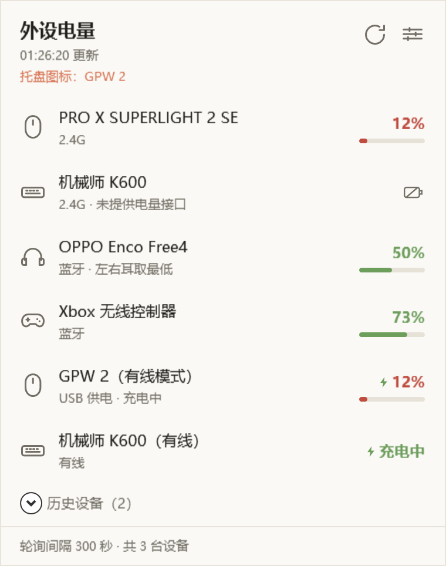
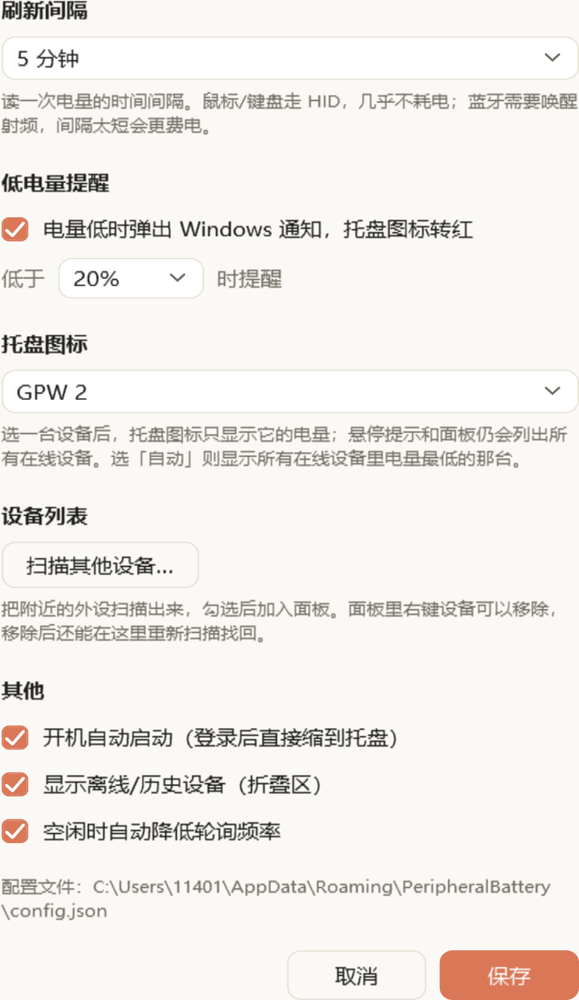
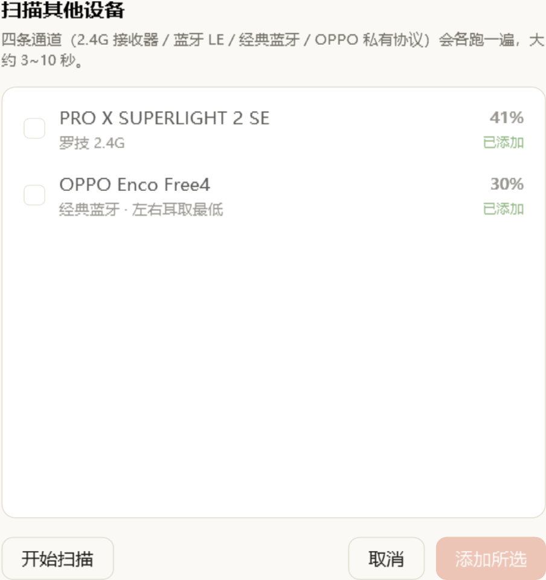

# 外设电量 / PeripheralBattery

[](https://github.com/yuudachi0621/PeripheralBattery/releases/latest)
[](LICENSE)
[](#)

PeripheralBattery 是一个 Windows 托盘工具，用于集中查看 2.4G 鼠标、键盘、蓝牙耳机和手柄的剩余电量。程序常驻后台，点击托盘图标即可打开面板；支持自定义设备名、离线设备历史、主设备、低电量提醒和主动扫描设备。



<p align="center"></p>
<p align="center"></p>

> 说明：界面截图和部分性能/设备读数来自开发机的历史记录，不代表所有硬件或当前环境都能得到相同结果。

---

## 功能

| 功能 | 行为 |
| --- | --- |
| 托盘常驻与弹出面板 | 左键点击托盘图标打开/关闭面板；面板贴在工作区右下角，失焦或按 `Esc` 收起。 |
| 开机自启 | 默认写入当前用户的 `HKCU\Software\Microsoft\Windows\CurrentVersion\Run`，启动参数为 `--tray`，登录后静默驻留托盘。 |
| 多来源电量 | 罗技 HID++、蓝牙 LE 标准电池服务、经典蓝牙在线状态、OPPO/OnePlus/realme 私有协议四路合并。 |
| 主动扫描与关注列表 | 常规轮询会跳过被明确移除（`Tracked=false`）的设备；“扫描其他设备…”会运行全部通道，可主动枚举并重新添加。没有配置记录的新设备 ID 当前默认按已跟踪处理。 |
| 设备管理 | 支持双击或右键重命名、恢复默认名称、设为主设备、取消主设备、从面板移除。正常跟踪期间，自定义名称按设备 ID 保存。 |
| 离线设备 | 可折叠显示“历史设备”、上次电量和最后在线时间；可在设置中完全隐藏离线设备。 |
| 充电/供电状态 | 有可靠状态时显示充电图标或“USB 供电”；没有可靠状态时不猜测。电量数字始终优先使用设备真实读数。 |
| 低电量提醒 | 电量小于等于阈值时，电量数字和电量条使用警示红；不在充电且未设主设备或主设备低电量时托盘图标转红。开启通知时弹出一条系统通知，同轮多台低电量只报最低的一台。 |
| 可调轮询 | 界面预设 10 秒、30 秒、1 分钟、2 分钟、5 分钟；手动刷新会立即执行。 |
| 低功耗策略 | 定时轮询、空闲降频、单轮互斥、图标按 5% 档位缓存、蓝牙连接读完即释放。 |
| 主题 | 启动时读取 Windows 应用主题，提供暖米白浅色和深色配色。 |

### 托盘与悬停提示

托盘图标显示的数值由“主设备”决定；未指定主设备时显示所有在线设备中的最低有效电量。主设备离线时图标变灰，不会退回显示其他设备。

悬停提示最多 63 个字符（Windows `NotifyIcon.Text` 限制），使用“电量前置 + 竖线分栏”格式：

```text
  41% | GPW 2
  30% | K600
+ 79% | 充电中的鼠标
```

- `+` 表示充电/USB 供电；面板中使用矢量闪电图标。
- 常规显示时设备名最多 20 个字符，超出用 `…` 收尾；空间不足时名称上限还会进一步收窄。
- 放不下时会优先保留全部设备，同时尝试压缩电量栏、缩短分隔符并逐步收窄名称；仍放不下时才只列部分设备并标注剩余数量。
- 面板和扫描窗口对“在线但无电量”使用“电池 + 斜杠”图标；悬停提示受纯文本限制，仍可能使用破折号。
- 主设备只影响托盘图标，不影响悬停提示和面板列表。

---

## 支持范围与数据来源

能否读取电量取决于设备是否公开了可用的电量接口。当前代码实现了以下四条通道：

| 通道 | 覆盖范围 | 主要数据来源 | 限制 |
| --- | --- | --- | --- |
| 罗技 HID++（界面标为 2.4G） | Lightspeed / Unifying / Bolt 等罗技接收器下的设备，以及可通过同一 HID++ 接口访问的直连设备 | HID++ 2.0：优先 `0x1004`，再尝试 `0x1000`、`0x1001` | 需要设备支持相应 HID++ 特性；当前无法仅凭该通道可靠区分接收器与直连接口，连接方式统一标为 2.4G。 |
| 蓝牙 GATT | 暴露标准电池服务 `0x180F` / 电量特征 `0x2A19` 的 BLE 设备 | Windows WinRT GATT | 只能读取当前已连接设备；未暴露标准服务的设备不会出现在此通道。 |
| 经典蓝牙 | 已连接且能识别类型的经典蓝牙外设 | Windows 连接状态 + PnP 电池属性 | 经典蓝牙没有统一电量命令；多数设备只能判断在线，不能读取电量。 |
| OPPO 耳机协议 | OPPO / OnePlus / realme 等使用 BBK 私有 RFCOMM 通道的 TWS 耳机 | 私有命令 `0x0106` 查询，左右耳取较低值 | 依赖设备公开对应 SDP/RFCOMM 服务，不对所有型号作保证。 |

此外，`BatteryMonitor` 会用 USB HID 产品名做有线连接兜底：当无线通道不再看到某台设备、但系统中存在同名 USB 直连 HID 接口时，将该设备恢复为在线并标记为有线。该关联依赖设备名称：名称不匹配时不会强行猜测，同时连接多台同名设备时存在误关联风险。

> 罗技 HID++ 通道会读取 `0x1004` 的外部供电状态；因此即使界面连接方式显示为 2.4G，也可能同时显示“USB 供电”或充电图标。连接方式标签与供电状态是两个独立字段。

### 开发机历史实测记录

以下记录保留自原项目文档，**本次 README 修订未重新连接这些硬件复测**：

| 设备 | 通道 | 历史结果 |
| --- | --- | --- |
| 罗技 GPW2 / PRO X SUPERLIGHT 2 SE | HID++ 2.0 | 可读取真实电量；插线时也显示真实读数，并带 USB 供电/充电标记。 |
| OPPO Enco Free4 | OPPO 私有 RFCOMM | 左右耳分别上报，程序显示较低值。 |
| Xbox 无线控制器 | BLE `0x180F` | 在 BLE 模式且设备暴露标准电池服务时可读取。 |
| 机械师 K600（蓝牙 / 2.4G） | 经典蓝牙 / ITE 接收器 | 未发现标准电量读数，显示在线和连接方式。 |
| 机械师 K600（USB 有线） | USB HID 名称匹配 | 可标记为“有线”；电量数字仍可能不可用。 |

> 设备固件、接收器、驱动和 Windows 版本都可能影响结果。新增型号支持前应先运行诊断探针，不要仅依据型号名称推断。

---

## 技术栈

| 类别 | 使用情况 |
| --- | --- |
| 语言与运行时 | C#、.NET 8，目标框架 `net8.0-windows10.0.19041.0`。 |
| 桌面 UI | WPF；托盘图标使用 Windows Forms `NotifyIcon`。 |
| 蓝牙 | Windows Runtime API：`BluetoothLEDevice`、GATT、`BluetoothDevice`、RFCOMM `StreamSocket`。 |
| HID / 系统设备 | `setupapi.dll`、`hid.dll`、`kernel32.dll` 等 P/Invoke；HID++ 2.0 在本项目中实现。 |
| 系统集成 | 注册表开机自启、`GetLastInputInfo` 空闲检测、`SystemEvents` 休眠/解锁通知、DWM 窗口属性。 |
| 配置与日志 | `System.Text.Json`；配置文件、日志和诊断报告均写入用户目录。 |
| 外部依赖 | 项目未声明 NuGet `PackageReference`，使用 .NET/WPF/WinForms 内置类型和 Windows API。 |

---

## 目录结构

```text
PeripheralBattery/
├─ App.xaml / App.xaml.cs         应用入口、单实例、托盘、系统事件、诊断参数分发
├─ PeripheralBattery.csproj       .NET 8 WPF/WinForms 项目配置
├─ app.manifest                   Per-Monitor V2 DPI 与 Windows 兼容性声明
├─ app.ico                        程序图标，可由 tools/make_icon.py 生成
├─ Models/
│  ├─ AppConfig.cs                配置模型、读写和只读诊断模式
│  ├─ DeviceModels.cs             设备快照、界面状态、调色板、矢量图标
│  ├─ DeviceDisplay.cs            主面板与扫描窗口共享的显示规则
│  └─ ScanItem.cs                 扫描结果和主设备下拉选项
├─ Native/
│  ├─ Hid.cs                      HID 枚举、Overlapped 读写和 Feature Report
│  ├─ Hidpp.cs                    HID++ 2.0 请求、特性发现、电量和电压换算
│  ├─ PnpBattery.cs               蓝牙 PnP 电池属性读取
│  └─ Power.cs                    空闲检测、DWM 圆角和深色标题栏
├─ Providers/
│  ├─ IBatteryProvider.cs         电量来源接口和设备类型猜测
│  ├─ LogitechProvider.cs         罗技 HID++ 通道（界面连接方式标为 2.4G）
│  ├─ BleProvider.cs              BLE 标准电池服务通道
│  ├─ BluetoothClassicProvider.cs 经典蓝牙在线状态与 PnP 电量
│  ├─ OpoProvider.cs              OPPO 私有协议通道
│  ├─ OpoLink.cs                  OPO 帧收发、配对和电量解析
│  └─ WinRtAsync.cs               WinRT 异步调用超时包装
├─ Services/
│  ├─ BatteryMonitor.cs           轮询调度、合并、在线判定、扫描、配置同步
│  ├─ LowBatteryWatcher.cs        低电量提醒判定和冷却
│  ├─ StartupManager.cs           HKCU Run 键管理
│  ├─ TextMetrics.cs              系统提示框字体宽度测量
│  └─ Log.cs                      %APPDATA% 运行日志
├─ UI/
│  ├─ PopupWindow.xaml(.cs)       主面板、右键菜单、重命名、刷新动画
│  ├─ SettingsWindow.xaml(.cs)    设置窗口
│  ├─ ScanWindow.xaml(.cs)        扫描其他设备
│  ├─ TrayIcon.cs                 托盘图标绘制、菜单和通知气泡
│  ├─ Theme.cs                    浅色/深色主题与电量配色
│  └─ Converters.cs               界面值转换器
├─ Diagnostics/
│  ├─ Probe.cs                    --probe 综合诊断
│  ├─ SelfTest.cs                 --selftest 逻辑自检
│  ├─ UiShot.cs                   --ui-shot 离屏截图
│  ├─ OpoProbe.cs                 OPPO 私有协议探针
│  ├─ HfpProbe.cs                 HFP AT 指令探针
│  ├─ SetupProbe.cs               PnP/SetupAPI 属性探针
│  └─ HeadsetProbe.cs             蓝牙耳机专项探针
├─ docs/                          README 截图和辅助资料
├─ tools/make_icon.py             图标生成脚本，依赖 Pillow
├─ dist/                          本地发布输出，已被 .gitignore 忽略
├─ README.md
└─ LICENSE
```

`.workbuddy/` 是本地开发记忆目录，也在 `.gitignore` 中，不属于运行代码或发布内容。

---

## 环境要求

### 运行

- Windows 10 版本 2004（内部版本 19041）或更高版本，或 Windows 11。
- 推荐 x64；项目目前只给出 `win-x64` 发布命令，ARM64 尚未验证。
- 按仓库中的框架依赖发布命令构建时，需要 .NET 8 Desktop Runtime。项目设置了 `RollForward=LatestMajor`，安装更高主版本的 .NET Desktop Runtime 也可尝试运行。
- 蓝牙功能需要 Windows 蓝牙栈、已配对且当前连接的设备；HID/2.4G 路径不依赖蓝牙。
- 普通使用和写入当前用户自启项不需要管理员权限。

### 开发与构建

- Windows 环境。
- .NET 8 SDK。
- 能运行 PowerShell 和 `dotnet` 命令。
- 项目本身没有需要手动还原的第三方 NuGet 包。
- 仅在重新生成 `app.ico` 时需要 Python 3 和 Pillow；运行程序或编译项目不需要它们。

> 最新 GitHub Release 中具体上传了哪些文件、是否为自包含构建，仓库内没有发布工作流可核对；如下载的是框架依赖版本，请安装对应的 .NET Desktop Runtime。

---

## 安装与运行

### 使用已发布版本

从 [Releases](https://github.com/yuudachi0621/PeripheralBattery/releases/latest) 下载 `PeripheralBattery.exe` 并运行。程序是托盘应用，不会创建长期可见的主窗口。

### 从源码构建

在仓库根目录执行：

```powershell
dotnet build -c Release
```

开发时也可直接构建并启动：

```powershell
dotnet run --project .\PeripheralBattery.csproj
```

生成框架依赖的单文件发布产物：

```powershell
dotnet publish -c Release -r win-x64 --self-contained false -p:PublishSingleFile=true -o dist
```

发布目录还会生成 `PeripheralBattery.pdb` 用于调试；分发运行时只需要 `PeripheralBattery.exe`。

启动：

```powershell
.\dist\PeripheralBattery.exe
```

`dist/` 已被 `.gitignore` 忽略，不会随源码提交。发布前如需清理或重建，请只在确认路径后处理该目录。

### 运行入口与命令行参数

下表假设当前目录保存着 `PeripheralBattery.exe`。PowerShell 不会仅凭文件名搜索当前目录，因此需要写成 `.\PeripheralBattery.exe`；如果程序在发布目录中，请使用 `.\dist\PeripheralBattery.exe` 或实际下载路径。

| 命令 | 用途 |
| --- | --- |
| `.\PeripheralBattery.exe` | 正常启动，创建托盘图标，并打开一次主面板。 |
| `.\PeripheralBattery.exe --tray` | 正常启动但不自动打开面板；开机自启使用该参数。 |
| 再次启动 `.\PeripheralBattery.exe` | 通过当前用户会话内的命名信号通知已有实例切换面板，不会启动第二个托盘进程。 |
| `.\PeripheralBattery.exe --probe` | 综合硬件诊断，输出 HID、HID++、蓝牙和电量原始信息。 |
| `.\PeripheralBattery.exe --selftest` | 运行内置逻辑自检。 |
| `.\PeripheralBattery.exe --probe-opo [关键字]` | 检查 OPPO/OnePlus/realme 私有协议。 |
| `.\PeripheralBattery.exe --probe-hfp [关键字]` | 检查 HFP `AT+IPHONEACCEV` 路径。 |
| `.\PeripheralBattery.exe --probe-setup [关键字]` | 检查 PnP/SetupAPI 设备属性。 |
| `.\PeripheralBattery.exe --probe-headset [关键字]` | 检查蓝牙耳机 GATT、RFCOMM 和系统缓存。 |
| `.\PeripheralBattery.exe --ui-shot <输出路径> [demo|settings|scan]` | 离屏渲染界面截图；`demo` 使用假数据，`settings`/`scan` 渲染对应窗口，`scan` 会执行真实扫描。 |

所有诊断入口都会在创建托盘图标前退出，并启用 `ConfigStore.ReadOnly`，避免覆盖真实配置。`--ui-shot` 还会在输出目录生成 `ui_tray.png`，并把布局检查写入运行日志。

诊断参数在主程序的单实例检查之前处理，因此即使托盘程序已经运行也可以执行。探针和 `scan`/`demo` 等会访问硬件的模式可能与正在运行的轮询争用蓝牙或 HID 设备。

> `--ui-shot` 必须同时提供输出路径，且输出目录需要事先存在；缺少路径时不会进入截图模式，而会继续正常启动流程。

---

## 使用说明

- **左键托盘图标**：打开/关闭主面板。
- **右键托盘图标**：立即刷新、设置、退出。
- **双击设备行**或右键选择“重命名…”：编辑设备名；`Enter` 保存，`Esc` 取消。
- **恢复默认名称**：清除该设备的自定义名称。
- **设为主设备 / 取消主设备**：改变托盘图标显示的电量来源。
- **从面板中移除**：设备不再出现在常规面板中；之后可通过“扫描其他设备…”重新添加。
- **Esc 或点击面板外区域**：收起面板。

面板电量颜色使用当前低电量阈值和固定档位：小于等于阈值为红色，阈值为 20% 时 21%~40% 为琥珀色，高于 40% 为暖绿色。正在充电/USB 供电只影响告警和充电图标，不会改写电量数字。

设置项：

| 设置 | 取值范围/行为 |
| --- | --- |
| 刷新间隔 | 10、30、60、120、300 秒；手动配置低于 5 秒会被加载逻辑修正为 5 秒。 |
| 低电量通知 | 开启时允许弹 Windows 通知；阈值选择仅在开启时可用。 |
| 低电量阈值 | 10%、15%、20%、30%；判定条件是电量 `<=` 阈值。 |
| 托盘图标 | “自动（所有在线设备最低值）”或指定一台设备。 |
| 扫描其他设备 | 运行四条通道并把勾选设备加入面板。 |
| 开机自动启动 | 写入或删除 HKCU Run 项。 |
| 显示离线/历史设备 | 控制面板中的离线折叠区。 |
| 空闲时自动降低轮询频率 | 空闲超过 5 分钟后，每 4 个定时周期只实际轮询 1 次。 |

---

## 配置、日志与数据文件

程序没有自定义环境变量。运行时使用 Windows 标准用户目录：

| 内容 | 路径 |
| --- | --- |
| 配置 | `%APPDATA%\PeripheralBattery\config.json` |
| 运行日志 | `%APPDATA%\PeripheralBattery\app.log` |
| 综合诊断 | `%TEMP%\pb_probe.txt` |
| 自检报告 | `%TEMP%\pb_selftest.txt` |
| OPPO 探针 | `%TEMP%\pb_opo.txt` |
| HFP 探针 | `%TEMP%\pb_hfp.txt` |
| SetupAPI 探针 | `%TEMP%\pb_setup.txt` |
| 耳机专项探针 | `%TEMP%\pb_headset.txt` |
| 开机自启 | `HKCU\Software\Microsoft\Windows\CurrentVersion\Run\PeripheralBattery` |

日志达到约 200 KB 后会删除旧文件并重新写入，不保留滚动历史。

### 配置文件

`config.json` 首次需要保存时创建。建议通过设置窗口修改；手工编辑前先退出程序，避免运行中的轮询覆盖修改。默认配置结构如下：

```json
{
  "PollSeconds": 60,
  "AutoStart": true,
  "ShowOffline": true,
  "ThrottleWhenIdle": true,
  "NotifyLowBattery": true,
  "LowBatteryPercent": 20,
  "PrimaryDeviceId": "",
  "Devices": {}
}
```

如果文件不存在、JSON 损坏或反序列化失败，程序会使用默认配置。加载时 `PollSeconds < 5` 会被修正为 5，`LowBatteryPercent` 超出 1~90 会被重置为 20。

| 字段 | 说明 |
| --- | --- |
| `PollSeconds` | 轮询间隔秒数。加载时小于 5 会被修正为 5。 |
| `AutoStart` | 是否写入当前用户 Run 键。 |
| `ShowOffline` | 是否显示离线/历史设备折叠区。 |
| `ThrottleWhenIdle` | 是否在空闲 5 分钟后降低轮询频率。 |
| `NotifyLowBattery` | 是否允许低电量通知。 |
| `LowBatteryPercent` | 低电量阈值；加载时超出 1~90 会被重置为 20。 |
| `PrimaryDeviceId` | 主设备 ID；空字符串表示自动选择最低电量。 |
| `Devices` | 以设备 ID 为键的内部设备档案。 |

`Devices` 中的记录由程序维护，包含自定义/默认名称、设备类型、连接类型、上次电量、最后在线时间、在线状态、来源通道和 `Tracked` 标记。`Tracked` 默认是 `true`，没有配置记录的未知设备 ID 也会被当作已跟踪。`Kind`、`Link` 以整数存储；如果手工修改，必须保持与代码中的枚举顺序一致，否则会被解释成其他类型。

---

## 架构与关键设计

### 启动与单实例

`App.OnStartup` 先处理诊断参数，再执行单实例检查。单实例使用 `Local\PeripheralBattery.Mutex` 和 `Local\PeripheralBattery.Show` 命名事件：第二次启动只通知已有实例切换面板，然后退出。使用 `Local\` 命名空间可以让同一登录会话内的多用户互不干扰。

### Provider 与合并流程

`IBatteryProvider` 表示一类硬件通道。每个 Provider 只返回本轮看到的设备，不缓存设备结果，也不负责离线判定或保存配置；连接句柄、设备索引等底层状态可以复用。

`BatteryMonitor` 的实现要点：

1. 罗技 HID 通道先独占执行，蓝牙类通道随后并行执行。开发记录显示同时密集建立蓝牙链路会显著拖慢 HID++ 读取，因此没有把所有通道简单并发。
2. USB 有线检测在后台并行执行，最多等待 5 秒；超时只跳过本轮有线兜底。
3. `ProviderResult.Ok == false` 表示整条通道不可用，此时不会据此把该通道名下的设备判离线；`Ok == true` 且设备列表为空才表示“通道正常但本轮没看到设备”。
4. 设备消失后需要连续两轮未被看到才标记离线，避免无线设备从省电状态唤醒时界面闪烁。
5. 某条原本有设备的通道本轮空手而归时，会在 3 秒后补一次轮询；补轮询有 30 秒限流，避免形成短时间循环。
6. 常规轮询只处理 `Tracked == true` 的设备；扫描接口绕过该过滤，但不会自动把发现的设备加入面板。

### 设备 ID

同一物理设备可能在多个通道中出现，因此使用稳定 ID 去重：

- 蓝牙 BLE、经典蓝牙和 OPPO 通道：`bt:{12 位十六进制蓝牙地址}`。
- 罗技设备：优先 `logi:{unitId:X8}`；读不到 `unitId` 时退回 `logi:{设备名}`。

`_providers` 的数组顺序同时也是同 ID 合并优先级：经典蓝牙先写入，OPPO 通道最后写入，因此 OPPO 的完整电量快照可以覆盖经典蓝牙的“在线但无电量”快照。调整 Provider 顺序前必须确认这个覆盖关系。

### 轮询与低功耗

- 使用 `System.Threading.Timer`，启动后约 300 ms 首轮，之后按配置间隔执行。
- 同一时刻只允许一轮轮询；手动刷新遇到正在执行时只登记一次待刷新。
- 单通道轮询有 25 秒取消超时；慢于 1.5 秒的通道会写日志。
- 用户空闲超过 5 分钟后，每 4 个周期只执行 1 次。
- 托盘图标按 5% 档位与低电量状态缓存，只有缓存键变化时才重绘。
- BLE / OPPO 连接用完立即释放；罗技接收器则刻意保留“热”句柄，减少无线设备唤醒失败和重复打开接口的开销。
- 休眠恢复和会话解锁后会立即补一次刷新。

### 低电量判定

`LowBatteryWatcher` 只决定是否应该提醒，气泡由 `App` 弹出：

- 正在充电或 USB 供电的设备不提醒。
- 电量 `<=` 阈值时触发；同轮多台低电量只选择最低的一台。
- 实现会先为同轮所有触发条件的设备记录提醒时间，再只返回最低的一台，因此其余设备不会在同一冷却期补弹。
- 同一设备提醒后进入 6 小时冷却。
- 充电后、电量超过阈值 +5，或用户保存设置使 watcher 重置时，允许再次提醒；阈值到阈值 +5（含）之间保留迟滞。
- 单纯的重新连接不会自动清除提醒记忆。
- 指定主设备时，只有主设备低电量会让托盘图标转红；通知判定仍会检查所有在线设备。

### 设备发现与关注

轮询可能看到同事的耳机、已配对但不使用的设备等；设计意图是把“发现”和“关注”分开，但当前实现没有完全隔离：

- 当前 `IsTracked(id)` 对没有配置记录的新 ID 返回 `true`，因此常规轮询发现新设备时可能自动把它加入面板；“只有扫描后才加入”的描述并不准确。
- 已被移除的设备保留 `Tracked=false`，常规轮询不会把它重新加回来。
- 扫描接口绕过 `Tracked` 过滤，返回本轮看到的所有设备；扫描窗口再过滤掉已跟踪条目，供用户显式添加。
- 离线时移除会删除记录，因此后续常规轮询可能再次自动发现它；在线时移除保留 `Tracked=false` 记录，可通过扫描重新添加。
- **待确认/修复：** 当前 `AddScanned` 在没有对应内存状态时会新建 `DeviceRecord` 并把 `CustomName` 置空，因此“移除后重新添加仍保留自定义名称”目前不能保证。

### 显示规则

主面板和扫描窗口共用 `DeviceDisplay`，避免两个界面出现不同口径：

- 有真实电量时始终显示真实百分比，充电时也不改成 100%。
- 有可靠充电/USB 供电状态时显示闪电或“充电中/供电”。
- 在线但无电量且不在充电时，面板显示“电池 + 斜杠”图标。
- 经典蓝牙 PnP 属性中的充电状态字段被明确忽略，因为开发机实测该字段在未插线时也会为真。

---

## 协议适配说明

### 罗技 HID++ 2.0

程序枚举罗技 `VID_046D` 且 Usage Page 为 `0xFF00` 的 HID 接口，优先使用 20 字节长报告。电量读取顺序为：

1. `0x1004 UNIFIED_BATTERY`：百分比、充电状态和外部供电状态。
2. `0x1000 BATTERY_LEVEL_STATUS`：百分比和部分充电状态位。
3. `0x1001 BATTERY_VOLTAGE`：读取毫伏并按锂电池放电曲线插值。

`0x1004` 中“电池正在充电”和“外接 USB 供电”不是同一概念。插线但已充满时，充电状态可能为 0，而外部供电状态仍非 0；界面因此仍显示供电/充电标记，但保留真实百分比。

当前 HID++ 通道统一把设备的 `LinkKind` 标成 `Receiver24G`。代码无法仅凭 HID++ 路径可靠区分接收器设备与 USB 直连设备，因此直连设备也可能显示“2.4G”；有线供电信息应结合 `ExternalPower` 和充电标记判断。

### OPPO / OnePlus / realme 私有协议

`OpoProvider` 在经典蓝牙 SDP 中查找以下 RFCOMM 服务之一：

```text
0000079a-d102-11e1-9b23-00025b00a5a5
00001107-d102-11e1-9b23-00025b00a5a5
```

连接后发送命令 `0x0106` 查询电量。响应载荷包含状态、部件数量和 `(part, raw)` 列表；`raw & 0x7F` 为百分比，`raw & 0x80` 为充电位，部件 `01/02/03` 分别表示左耳/右耳/充电盒。当前显示取左右耳较低值；没有左右耳有效数据时才回退到充电盒电量。

### 机械师 K600

历史探针记录显示，`VID_048D&PID_C102` 接收器没有 HID 标准电量 Usage，也没有可用的 BLE/HID++ 电量通道，因此不能可靠读取数字。K600 的“有线”状态由 USB HID 产品名匹配得到，而不是由 PnP 充电字段推断。

---

## 测试与验证

项目没有独立的单元测试工程，主要验证方式是能够运行的内置自检和硬件诊断。

### 构建验证

```powershell
dotnet build -c Release
```

### 内置逻辑自检

```powershell
.\dist\PeripheralBattery.exe --selftest
```

或对构建输出目录中的 `PeripheralBattery.exe` 执行相同命令。自检当前包含 117 项断言，覆盖低电量提醒、主设备、设备移除与恢复、悬停提示长度/对齐、充电标记、未知电量显示和 USB 有线兜底等逻辑。结果写入 `%TEMP%\pb_selftest.txt`。

> 当前 `--selftest` 无论断言是否失败都会以退出码 0 结束，必须查看报告末尾的“全部通过”或失败数量，不能只依赖进程退出码。

### 界面回归

```powershell
.\dist\PeripheralBattery.exe --ui-shot D:\tmp\ui.png
.\dist\PeripheralBattery.exe --ui-shot D:\tmp\ui.png demo
.\dist\PeripheralBattery.exe --ui-shot D:\tmp\ui.png settings
.\dist\PeripheralBattery.exe --ui-shot D:\tmp\ui.png scan
```

`D:\tmp` 必须已经存在。不传模式时会执行一次真实轮询；`demo` 也会先执行一次真实轮询，再注入假设备覆盖低电量、未知、充电、USB 供电和离线等视觉状态；`settings` 只渲染设置窗口；`scan` 会真实运行四条硬件通道。布局溢出检查写入 `%APPDATA%\PeripheralBattery\app.log`。

### 硬件验证

硬件适配没有通用自动化测试。新增或排查设备时建议运行：

```powershell
.\dist\PeripheralBattery.exe --probe
.\dist\PeripheralBattery.exe --probe-headset <关键字>
.\dist\PeripheralBattery.exe --probe-hfp <关键字>
.\dist\PeripheralBattery.exe --probe-opo <关键字>
.\dist\PeripheralBattery.exe --probe-setup <关键字>
```

---

## 部署与发布

仓库当前没有安装程序、服务、计划任务或 CI/CD 发布工作流。已知的源码部署方式是通过 `dotnet publish` 生成 Windows x64 单文件程序，然后分发 `dist\PeripheralBattery.exe`。

框架依赖单文件发布需要目标机器安装相应 .NET Desktop Runtime。若需要完全自包含发布，可评估 `--self-contained true`，但这会显著增大产物，且当前仓库中的发布命令和 GitHub Release 流程尚未体现该方式。

发布前建议至少完成：

1. `dotnet build -c Release`
2. `dotnet publish -c Release -r win-x64 --self-contained false -p:PublishSingleFile=true -o dist`
3. `.\dist\PeripheralBattery.exe --selftest`
4. `.\dist\PeripheralBattery.exe --ui-shot <已存在目录>\ui.png demo`
5. 在目标 Windows 版本上用真实设备验证 HID、BLE 和经典蓝牙通道

---

## 常见问题

### 鼠标电量一直读不到

先看 `--probe` 输出中罗技设备对应的 HID++ 通道，确认设备支持 `0x1004`、`0x1000` 或 `0x1001`。不支持时程序无法凭空算出电量。

### 刚启动时设备显示“离线 · 刚刚”

无线设备从省电状态唤醒时，首个请求可能被吞掉。程序会等待下一轮，或在通道空手而归时 3 秒后补试；连续两轮未读到才会判离线。也可以点“立即刷新”。

### 没有显示某台设备

- 确认设备已开机、已配对并处于连接状态。
- 使用“设置 → 扫描其他设备…”重新查找。
- 如果此前从面板移除过，可以重新扫描添加；但当前实现可能重建设备记录并丢失自定义名称，详见“尚未验证与已知限制”。
- 若设备不提供标准电量接口，扫描窗口也可能不会列出它。

### 托盘图标是灰色

表示当前没有可显示的托盘电量：可能是所有设备离线/无电量，或指定的主设备离线。查看 `app.log` 中各通道是否失败。

### 托盘图标一直显示某台设备

你设置了主设备。面板标题下会显示“托盘图标：设备名”；在设备右键菜单中取消主设备即可恢复自动显示最低值。

### 面板一闪就消失

面板失焦会自动收起。程序忽略了弹出后约 250 ms 内的失焦事件；若仍能稳定复现，请附上日志和复现步骤。

### 耳机电量与手机 App 不一致

不同软件可能采用不同统计方式。当前 OPPO 通道显示左右耳中的较低值，手机 App 可能显示平均值或其他口径。

---

## 扩展新的电量来源

实现 `IBatteryProvider`，并遵守以下约定：

```csharp
public sealed class MyProvider : IBatteryProvider
{
    public string Name => "我的设备";

    public Task<ProviderResult> PollAsync(CancellationToken ct)
        => Task.FromResult(new ProviderResult
        {
            Ok = true,
            Devices =
            {
                new DeviceSnapshot
                {
                    Id = "my:1",
                    Name = "XX 键盘",
                    Kind = DeviceKind.Keyboard,
                    Link = LinkKind.Receiver24G,
                    Percent = 77,
                }
            }
        });
}
```

然后在 `BatteryMonitor` 构造函数中注册。扩展时必须注意：

- 只返回本轮实际看到的设备，不要缓存上一轮结果。
- 同一物理设备跨通道使用相同 ID。
- 整条通道失败时返回 `Ok=false`，不要用空列表表示失败。
- 完成蓝牙/RFCOMM/GATT 访问后及时释放连接。
- 如果新 Provider 走 USB HID，应和现有 HID 通道同组；如果走蓝牙类链路，应和蓝牙通道同组，避免破坏当前的并发策略。
- 调整 `_providers` 顺序会改变同 ID 的合并优先级。

当前架构不是插件式发现，新增 Provider 需要修改源码并重新编译。

---

## 尚未验证与已知限制

- 本次修订依据源代码、项目文件、依赖清单和现有文档检查完成；没有重新连接所有历史测试设备做硬件复测。
- Windows ARM64、Windows 10 低于 2004 的版本尚未验证。
- 最新 GitHub Release 的实际文件组成、代码签名和自包含方式未从仓库内确认。
- 没有独立单元测试项目，也没有 CI 工作流；`--selftest` 是手工执行的自检程序。
- `--selftest` 当前始终以退出码 0 结束，自动化流水线若接入必须解析报告内容。
- 蓝牙能力依赖设备固件、驱动和 Windows 蓝牙栈；同一型号在不同固件版本上可能表现不同。
- 未知设备 ID 的 `Tracked` 默认值为 `true`，所以“发现”和“关注”当前没有完全隔离；首次见到的设备可能自动进入面板，需后续修复产品行为。
- 主题在启动时检测，当前实现没有监听 Windows 主题实时变化。
- 重新添加已移除设备时，`AddScanned` 可能用空 `CustomName` 覆盖旧记录；当前不能保证保留自定义名称，需后续修复或明确产品行为。
- 罗技 HID++ 通道无法可靠区分接收器与 USB 直连接口，界面连接方式统一标记为 2.4G；有线供电需结合充电/供电标记判断。
- 性能数字和具体设备电量读数属于开发机历史记录，不是跨环境指标保证。

---

## 许可证

[MIT](LICENSE) © 2026 yuudachi0621
